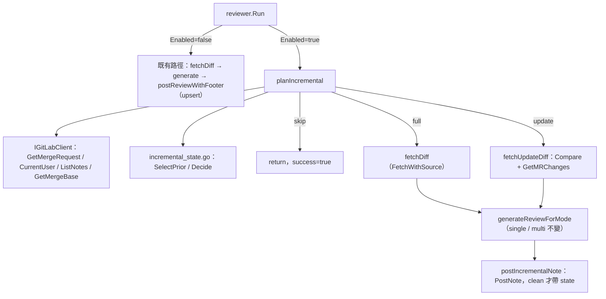
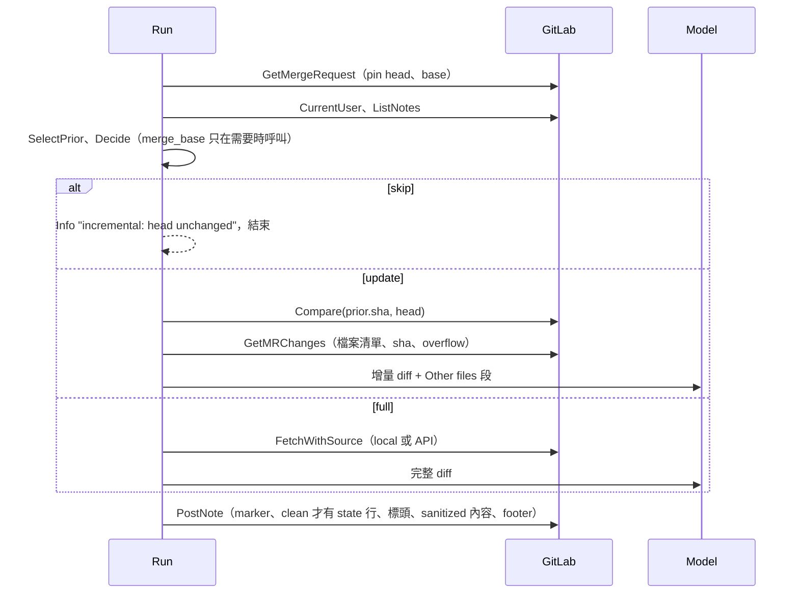

# design-be — incremental-review

Implements `REQ-01`–`REQ-06`（spec.md，fingerprint `082341df59f84a6f…`）。純 backend/CLI：design-fe.md 與 api.yml 均 N/A（本 change 只呼叫 GitLab API，不對外提供 API）。

## 模組配置

| 位置 | 內容 | 對應 REQ |
|---|---|---|
| `internal/config/config.go`（`Config`、`load` 的 Enrichment 區塊 :235-241、`parseBoundedInt` :308） [MODIFY] | 新增 `Incremental IncrementalConfig{Enabled bool; FullEvery int}`；`MRI_INCREMENTAL_REVIEW` 用 `getEnv(...)=="true"`，`MRI_INCREMENTAL_FULL_EVERY` 用 `parseBoundedInt(key, 5, 0, 100)` | REQ-01 |
| `internal/config/envexample_test.go`（canonical :14 起，字母序）、`.env.example` [MODIFY] | 加入兩個變數 | REQ-01 |
| `internal/gitlab/types.go`（`MergeRequest` :9、`Change` :21、`MRChangesResponse` :43、`Note` :48） [MODIFY] | `MergeRequest.SHA`、`MergeRequest.DiffRefs.BaseSHA`；`MRChangesResponse.SHA`；`Note.CreatedAt`、`Note.UpdatedAt`（string）；`Change.TooLarge`、`Change.Collapsed`；新型別 `CompareResponse{Diffs []Change; CompareTimeout bool}` | REQ-03、REQ-05 |
| `internal/gitlab/client.go`（`getJSON` :165） [MODIFY] | 新方法 `GetMergeBase`、`Compare`，沿用 `getJSON`／`doWithRetry` | REQ-05 |
| `internal/interfaces/interfaces.go`（`IGitLabClient` :13、`IDiffFetcher` :24） [MODIFY] | `IGitLabClient` 加兩個方法；新增窄介面 `IDiffSourceFetcher { FetchWithSource(ctx, src, tgt string) (patch, sourceSHA string, err error) }`，不改 `IDiffFetcher` | REQ-05、REQ-06 |
| `internal/diff/local.go`（`Fetch` :23，`sourceHash` :29-35）、`internal/diff/api.go`（`Fetch` :31）、`internal/diff/fallback.go`（`Fetch` :22） [MODIFY] | 三個 fetcher 實作 `FetchWithSource`；`Fetch` 改為呼叫它並丟掉 SHA，行為不變。local 回本機解析到的 source hash；API 回 `GetMRChanges` 的 `sha`；fallback 回實際走的那條路的 SHA | REQ-06（reviewed SHA） |
| `internal/testfake/gitlab_client.go`（`FakeGitLabClient` :104，計數欄位 :125-131）、`internal/reviewer/reviewer_test.go`（`fakeGitLab` :517） [MODIFY] | 兩個 fake 實作新方法並記錄呼叫次數；`fakeGitLab` 另補 `PostNote`／`GetMRChanges`／`GetMergeRequest`／`ListNotes` 計數 | REQ-05 |
| `internal/reviewer/incremental_state.go` [NEW] | `State`、`FormatState`、`ParseState`、`SelectPrior(notes, botID)`、`Decide(prior, head, base, fullEvery, isAncestor)`；純函式，不碰 I/O | REQ-03、REQ-04 |
| `internal/reviewer/incremental.go` [NEW] | `incrementalRun`（pinned head/base、decision、`dirty []string`）；`planIncremental`、`fetchUpdateDiff`、`otherFilesSection`、`postIncrementalNote`；每個降級原因都經 `markDirty(reason)` 寫一行 Warn | REQ-04、REQ-05、REQ-06 |
| `internal/reviewer/reviewer.go`（`Run` :179、`fetchMRDetails` :297、`fetchDiff` :311、`fetchedDiff` :39、`postReviewWithFooter` :558） [MODIFY] | `Run` 在開關開啟時改走 incremental 分支；`fetchedDiff` 加 `sourceSHA`、`changesSHA`、`changesOverflow`、`changesErr`；開關關閉時這些欄位不被讀取，`postReviewWithFooter` 不動 | REQ-02、REQ-06 |
| `AGENTS.md`（`## Key Environment Variables` :101）、`docs/us|tw/configuration.md`（:61 附近）、`docs/us|tw/architecture.md`（:37） [MODIFY] | 變數表與「更新那則 note」的開關例外 | REQ-01 |

## Table schema

N/A：沒有資料庫。唯一的持久狀態是 note 內的 state comment，格式以 spec REQ-03 為唯一來源，此處不重述。

## 服務關係

## 執行序

## 關鍵設計決定

1. **reviewed SHA 的取得**：`IDiffFetcher.Fetch` 只回 patch，本機 hash 被丟掉。新增窄介面 `IDiffSourceFetcher` 而非改 `IDiffFetcher` 簽章（D3：`IDiffFetcher` 有 3 個實作與多個測試替身；加一個平行方法不動既有呼叫端）。reviewer 以 type assertion 取用；沒有實作 → `sourceSHA=""` → 視為不 clean、不寫 state（失敗只會多審）。`FallbackDiffFetcher` 的 `primary`／`secondary` 欄位型別維持 `IDiffFetcher`（fallback.go:13-14），其 `FetchWithSource` 對實際走的那一個做 type assertion，不支援時回 `""`，同樣落入不寫 state。
2. **update review 的 diff 不走 fetcher**：直接用 `Compare(...).Diffs` 進既有 `reduceDiff`／`ConvertChangesToDiff`；檢查順序：`Compare` 錯誤 → `CompareTimeout` → 任一 `TooLarge`／`Collapsed`／`Truncated()`，任一命中即改走 full 並 Warn 一行，但不呼叫 `markDirty`：降級為 full 本身不讓 state 變髒，spec S-08 (b)–(e) 仍寫 full state，之後照 full 的規則檢查 reviewed SHA。
3. **MR 檔案清單段**：附在 reduce 後 diff 文字的尾端、與最後一個 diff 區塊隔一個空行，標題一行在前，不加 `diff --git` 標頭；附加時機在 `reduceDiff` 與 `ValidateDiff` 之後，因此不計入 diffbudget（最多 200 條路徑，大小有界），也不影響檔案計數；因此 `diff.HasFileSection` 不會把清單裡的路徑當成 diff 檔案；single 與每個 lane 都吃同一份 diff 文字，自動涵蓋兩種模式，`prompt` 與 `lane` 套件不改。
4. **clean run 判定集中一處**：`incrementalRun.dirty` 收集 spec REQ-06 的五類原因；`postIncrementalNote` 只看 `len(dirty)==0` 決定是否寫 state 行。lane 失敗與 `degradedToSingle` 從 `generateReviewForExplicitModeWithStatus` 已回傳的狀態取得（`footerAggregation.degradedToSingle`、`FanoutResult.Failures`），不新增旁路。
5. **note 組裝**：`ReviewNoteMarker + "\n" + [state 行 + "\n"] + 標頭 + "\n\n" + SanitizeInput(content+footer)`；state 行與標頭都在 sanitize 之外拼上，值只來自 `incrementalRun`。開關開啟時從不呼叫 `UpdateNote`。
6. **`Decide` 的 ancestry 參數為 `isAncestor func() bool`**：spec REQ-04 要求 merge_base 只在「prior 存在、head 與 base 不全相同、未達上限」時呼叫。把它做成 lazy 參數，由 `Decide` 只在決策表最後兩列才呼叫，決策條件只存在 `Decide` 一處，`planIncremental` 不重抄決策表。呼叫失敗由傳入的 closure 自行 Warn 並回 false。
7. **project ID**：`GetMergeBase`、`Compare` 一律傳 validator 已解析的 `projectID`（與 `GetMergeRequest` 同一來源；trigger 模式即 `MRI_PROJECT_ID`），T5 測試斷言 fake 收到的 project ID。
8. **skip 的成功語意**：skip 在 `fetchDiff` 前 return，並讓 `Run` 的 deferred log（reviewer.go:186-196）記 `success=true`。
9. **設計模式**：現有程式掃描到的相似實作只有 `postReviewWithFooter` 的 upsert，不構成重複結構或可預期的變化點；依 `wiki/coding_standard/23-design-patterns.md` 不引入任何 GoF pattern。`Decide` 是單一純函式加決策表，不做 Strategy。

## 實作順序的硬性依賴

- T2（client、`Note` 時間欄位與兩個 fake）在 T3–T6 之前：T3 需要 `Note.CreatedAt`／`UpdatedAt`；reviewer 測試需要 fake 的新方法與計數才能編譯。
- T3（純函式）在 T4–T6 之前。
- T4（S-02、S-05）在 T5、T6 之前：先鎖住關閉路徑的 golden，再改 `Run`。
