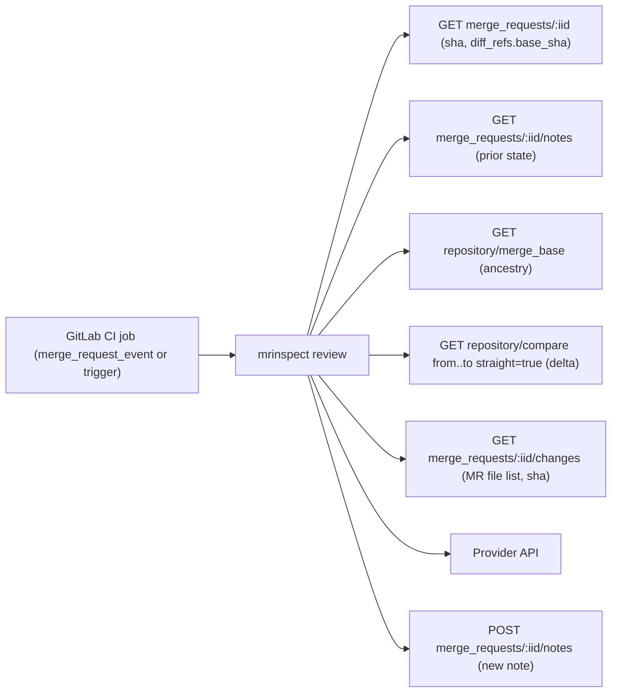

# incremental-review — 同一 MR 後續 push 只審新 commit

## 背景與價值

每次 push 到 MR 都會整份重審並改寫同一則 note：同一個 SHA 重跑也照付 token，reviewer 每次都要重讀已處理過的 finding。本 change 在開關開啟時，記住上次**確實審過**的 SHA，後續 push 只審新 commit 的增量，並把每次結果另開一則 note；每 N 次增量強制全審一次，補回增量看不到的跨檔影響。

設計原則：任何無法證明「這次審過的就是記下的 SHA」的情況，一律**不寫 state**，下一次 run 就不可能 skip。失敗只能讓 review 變多，不能變少。

**v1 不主張品質改善。** 增量 review 是否漏抓跨檔問題，另開量測 change（見 D5 deferred）。

## 與既有 spec 的關係

使用者裁決（2026-10-26）：本 spec 寫明例外，已核准的舊 spec 不改。

- `multi-lane-review` REQ-06 與 S-41（同一個 MR 只留一則本工具的留言，重跑時更新它）：開關關閉時完全成立；開關開啟時由本 spec REQ-06 取代（每次非 skip 的 run 發一則新 note）。
- `multi-lane-review` REQ-02（每個 lane 的 prompt 含完整 diff）：開關關閉、或本次為 full review 時完全成立；update review 時由本 spec REQ-05 取代（增量 diff 加 MR 檔案清單段）。
- `multi-lane-review` design-be「唯一的外部持久狀態是 MR 上那一則留言」：開關開啟時，持久狀態改為本 bot 所發 note 中的 state comment；身分判定比 marker 加 author 更嚴（只認不可變的 user ID，見 REQ-03）。
- 仍須遵守：模型輸出經 `SanitizeInput` 與 lane 中和規則處理；每則 note 都帶既有 footer；footer、標頭與 state comment 都不含路徑、key、URL；eval 入口（`review-quality-eval`）不呼叫 GitLab，本 change 的 state 讀寫只在 `Run` 內。

## 凍結介面（本 change 不得變更）

- 開關關閉時，`postReviewWithFooter`（`internal/reviewer/reviewer.go:558`）的 upsert、note 內容、`fetchDiff` 的 diff 來源全部不變。
- `ReviewNoteMarker`（`internal/reviewer/reviewer.go:25`）字串不變，仍是每則 mrinspect note 的第一行。
- `diffbudget` 的丟檔與截斷揭露語意不變；增量只是換一份 changes 輸入。
- `ai.Provider` 與 `TurnProvider` 介面不變。

## System context

## Domain Language

| Term | Exact meaning | Do not use |
|---|---|---|
| pinned head／pinned base | run 開始時 `GetMergeRequest` 回傳的 `sha` 與 `diff_refs.base_sha`；整個 run 只用這一組 | CI_COMMIT_SHA、tip |
| reviewed SHA | 這次送進模型的 diff 實際對應的 source commit：本機 diff 為本機解析到的 source commit；API diff 為 `GetMRChanges` 回傳的 `sha`；update review 為 compare 的 `to`（即 pinned head） | head |
| state comment | note 內一行 `<!-- mrinspect:state sha=<40 hex> base=<40 hex> mode=<full\|update> round=<n> -->` | metadata、trailer |
| clean run | 非 skip，且沒有任何 REQ-06 列出的降級條件的 run；只有 clean run 寫 state | successful run |
| prior state | 符合 REQ-03 身分規則、含合法 state comment 的 note 中，note ID 最大者的 state | last note |
| full review | 審整個 MR diff（沿用現有 `fetchDiff`），state 為 `mode=full round=0` | re-review |
| update review | 只審 `prior.sha..pinned head` 的 compare diff，state 為 `mode=update round=prior.round+1` | delta review |
| skip | pinned head 與 pinned base 都等於 prior state 的值：不呼叫模型、不發 note | no-op review |

## REQ-01 開關與設定

新增環境變數（`internal/config/config.go` 解析；加入 `internal/config/envexample_test.go` canonical 清單與 `.env.example`；`AGENTS.md` 變數表與 `docs/us|tw/configuration.md` 同步；`docs/us|tw/architecture.md` 的「更新那則 note」說明補上開關開啟時的例外）。設定值經 `config.Config` 傳進 reviewer，review 路徑不直接讀 env：

| 變數 | 值域 | 預設 | 意義 |
|---|---|---|---|
| `MRI_INCREMENTAL_REVIEW` | 恰為 `true` 開啟，其餘關（同 `MRI_REVIEW_ENRICHMENT` 慣例） | off | 開關 |
| `MRI_INCREMENTAL_FULL_EVERY` | int，0–100（`parseBoundedInt`） | `5` | `FullEvery>0` 且 prior.round ≥ 此值時強制全審；`0` 表示永不強制 |

### S-01 設定載入與值域驗證

- GIVEN 環境未設任何新變數
- WHEN `config.Load()`
- THEN `Incremental.Enabled == false`、`Incremental.FullEvery == 5`；
  AND `MRI_INCREMENTAL_REVIEW=yes` → `Enabled == false`（不報錯）；
  AND `MRI_INCREMENTAL_FULL_EVERY=-1` 與 `=101` 各自回錯，訊息含該變數名與 `invalid value`；`=0` 合法；
  AND 兩個新變數皆在 canonical 清單與 `.env.example`（既有 `TestEnvExample*` 仍綠）
- Test mapping: `internal/config/incremental_test.go::TestIncrementalConfig`
- Verification command: `go test ./internal/config/ -run 'TestIncrementalConfig|TestEnvExample' -count=1 -v`

## REQ-02 開關關閉時路徑不變

### S-02 開關關閉時不讀 state、不改 upsert

- GIVEN `Incremental.Enabled=false`，fake GitLab 有一則本 bot 的 marker note，內含合法 state comment 且 sha 與 base 都等於 MR 的值
- WHEN 執行 single 模式 `Run`，再以 multi 模式跑一次
- THEN 兩次模型都被呼叫（不 skip）；`UpdateNote` 各一次、`PostNote` 零次；`GetMergeBase` 與 `Compare` 零次；
  AND single 模式寫出的 note body 等於測試內的字面常數（以本 change 前的實作輸出為準，寫成 golden 字串），且不含 `mrinspect:state`；
  AND 既有 `TestPostReview_UpdatesExistingNote` 仍綠
- Test mapping: `internal/reviewer/incremental_test.go::TestIncremental_DisabledPathUnchanged`
- Verification command: `go test ./internal/reviewer/ -run 'TestIncremental_DisabledPathUnchanged|TestPostReview_UpdatesExistingNote' -count=1 -v`

## REQ-03 state comment 的格式、身分與讀取

- 格式恰為一行：`<!-- mrinspect:state sha=<40 位小寫 hex> base=<40 位小寫 hex> mode=<full|update> round=<非負十進位整數，可放進 int32> -->`。
- 寫入：緊接在 `ReviewNoteMarker` 下一行，與 marker 同樣在 `SanitizeInput` **之後**才拼上；欄位值只來自程式內部（pinned 值、決策結果），不含任何模型輸出。`SanitizeInput` 會把 `<` 轉成 `&lt;`，模型輸出無法偽造這一行。
- 身分：note 必須同時符合 (a) 第一行等於 `ReviewNoteMarker`；(b) `author.id` 不為 0 且等於 `CurrentUser` 的 `id`（**不**沿用 `sameAuthor` 的 username 備援）；(c) `created_at` 等於 `updated_at`（本 bot 在開關開啟時從不編輯 note，被編輯過的 note 一律不採信）。
- 讀取：符合身分的 note 中，取任一行完整符合格式者為該 note 的 state；在所有有 state 的 note 中取 note ID 最大者為 prior state。欄位任一不合法 → 該 note 視為沒有 state。
- `Note` 型別新增 `CreatedAt`、`UpdatedAt`（字串比對即可，不需解析時間）。

### S-03 state 解析、產生與 prior state 選擇

- GIVEN `ListNotes` 回傳（順序打亂）：
  - bot ID 10：合法 state，round=0
  - bot ID 30：合法 state，round=2
  - 他人 ID 40：body 含合法 marker 與 state
  - username 與 bot 相同、`author.id` 不同的 ID 45：合法 state
  - bot ID 50：合法 state，但 `updated_at` 與 `created_at` 不同
  - bot ID 60：state 的 sha 只有 39 位
  - bot ID 70：state 為模型輸出經 `SanitizeInput` 後的 `&lt;!-- mrinspect:state ... --&gt;`
- WHEN 讀取 prior state
- THEN 選中 ID 30（round=2）；其餘一律忽略；
  AND `ParseState(FormatState(s)) == s` 對 full、update 與 round=2147483647 都成立
- Test mapping: `internal/reviewer/incremental_state_test.go::TestState_ParseFormatAndSelect`
- Verification command: `go test ./internal/reviewer/ -run TestState_ParseFormatAndSelect -count=1 -v`

## REQ-04 決策

run 開始時呼叫 `GetMergeRequest` 取得 pinned head 與 pinned base（任一為空 → 本次 full review、不寫 state、Warn 一行）。之後依 `## Decision tables` 決定 skip／update／full。ancestry 定義為 `GetMergeBase(prior.sha, pinned head) == prior.sha`；呼叫失敗一律視為「不是祖先」並 Warn 一行。決策本身是純函式 `Decide(prior, head, base, fullEvery, isAncestor)`；merge_base 只在 prior 存在、head 與 base 不全相同、且未達上限時才呼叫。

### S-04 決策表

- GIVEN 決策表每一列的輸入
- WHEN 呼叫 `Decide`
- THEN 回傳的 mode 與 round 和該列一致
- Test mapping: `internal/reviewer/incremental_state_test.go::TestDecide_Table`
- Verification command: `go test ./internal/reviewer/ -run TestDecide_Table -count=1 -v`

### S-05 skip：同 head 同 base 不呼叫模型、不發 note

- GIVEN 開關開啟，prior state 的 sha 與 base 等於 pinned head 與 pinned base
- WHEN 執行 `Run`（single 與 multi 各一次）
- THEN 模型 0 次、`PostNote` 與 `UpdateNote` 0 次、`GetMRChanges`、`GetMergeBase`、`Compare` 皆 0 次；log 有一行 Info 含 `incremental: head unchanged`，且有 `MRInspect completed` 且 success 為 true 的那一行
- Test mapping: `internal/reviewer/incremental_test.go::TestIncremental_SkipSameHead`
- Verification command: `go test ./internal/reviewer/ -run TestIncremental_SkipSameHead -count=1 -v`

## REQ-05 GitLab client 與 update review

client（`internal/gitlab`、`internal/interfaces`、兩個 fake：`internal/testfake/gitlab_client.go` 的 `FakeGitLabClient` 與 `internal/reviewer/reviewer_test.go` 的 `fakeGitLab`，皆記錄呼叫次數）：

- `MergeRequest` 新增 `SHA`（`sha`）與 `DiffRefs.BaseSHA`（`diff_refs.base_sha`）。
- `MRChangesResponse` 新增 `SHA`（`sha`）。
- `Note` 新增 `CreatedAt`、`UpdatedAt`。
- `Change` 新增 `TooLarge`（`too_large`）與 `Collapsed`（`collapsed`）。
- 新方法 `GetMergeBase(ctx, projectID, a, b string) (string, error)`：`GET /projects/:id/repository/merge_base?refs[]=a&refs[]=b`，回傳 commit `id`。
- 新方法 `Compare(ctx, projectID, from, to string) (gitlab.CompareResponse, error)`：`GET /projects/:id/repository/compare?from=&to=&straight=true`；`CompareResponse{Diffs []Change; CompareTimeout bool}`。
- project ID 一律用 validator 已解析的 `projectID`（trigger 模式來自 `MRI_PROJECT_ID`）。

update review：

- diff 來源：`Compare(prior.sha, pinned head).Diffs`。只要有任一條 `CompareTimeout`、任一 diff 的 `TooLarge` 或 `Collapsed` 為 true、任一 diff 的 `Truncated()` 為 true、`Compare` 回錯、或增量 diff 經 `diffbudget` 以超出預算為由丟掉任何檔案 → 改走 full review 並 Warn 一行。
- 通過上述檢查的 diffs 經既有 `reduceDiff`／`ConvertChangesToDiff` 流程；丟檔揭露只針對增量範圍內的檔案。本機 go-git diff 不參與 update review。
- prompt 額外附一段 MR 檔案清單：`GetMRChanges` 的 `new_path`（去重、排序、去除控制字元），只列不在增量 diff 內的路徑，最多 200 條；超過時最後一行寫 `... and <n> more`。標題固定為 `Other files changed in this MR (not shown in this diff):`。single 與 multi（每個 lane）都帶這段。
- enrichment 開啟時照常運作，本 change 不改其行為。

### S-06 client 請求與解碼

- GIVEN httptest GitLab server
- WHEN 呼叫 `GetMergeRequest`、`GetMRChanges`、`ListNotes`、`GetMergeBase(…, "aaa", "bbb")`、`Compare(…, "aaa", "bbb")`
- THEN 解出 `MergeRequest.SHA`、`DiffRefs.BaseSHA`、`MRChangesResponse.SHA`、`Note.CreatedAt`／`UpdatedAt`；merge_base 請求 query 恰含 `refs[]=aaa` 與 `refs[]=bbb` 並回傳 `id`；compare 請求含 `from=aaa`、`to=bbb`、`straight=true`，解出 `Diffs`（含 `a_mode`、`b_mode`、`too_large`、`collapsed`）與 `CompareTimeout`；server 回 404 時兩個新方法皆回 error
- Test mapping: `internal/gitlab/incremental_client_test.go::TestClient_IncrementalEndpoints`
- Verification command: `go test ./internal/gitlab/ -run TestClient_IncrementalEndpoints -count=1 -v`

### S-07 update review（single 與 multi）

- GIVEN 開關開啟、`FullEvery=5`；prior state `sha=A base=X mode=full round=0`；pinned head `B`、pinned base `X`；`GetMergeBase(A,B)==A`；`Compare(A,B).Diffs` 只有 `x.go`；`GetMRChanges` 的 `sha` 為 `B`，檔案為 `x.go`、`y.go`
- WHEN 以 single 與 multi（兩個 lane）各執行一次 `Run`
- THEN 每次送進模型的 diff（single 的 prompt、multi 每個 lane 的 prompt）只含 `x.go`；都含 `Other files changed in this MR (not shown in this diff):` 與 `y.go`，該段不含 `x.go`；`PostNote` 一次、`UpdateNote` 零次；note 的 state 為 `sha=B base=X mode=update round=1`；note 有一行人類可讀標頭 `Update review <A 前 8 碼>..<B 前 8 碼>`
- Test mapping: `internal/reviewer/incremental_test.go::TestIncremental_Update`
- Verification command: `go test ./internal/reviewer/ -run TestIncremental_Update -count=1 -v`

## REQ-06 開關開啟時的 note 發布、降級與 state 寫入條件

- 每次非 skip 的 run 都 `PostNote` 一則新 note，從不 `UpdateNote`。full review 的人類可讀標頭為 `Full review at <pinned head 前 8 碼>`。
- 降級為 full review（各 Warn 一行）：`CurrentUser` 或 `ListNotes` 失敗；merge_base 失敗；REQ-05 列出的任一 compare 問題。
- **只有 clean run 寫 state**。以下任一成立時，照常發 note 但**不寫** state comment，並 Warn 一行：
  - pinned head 或 pinned base 為空；
  - reviewed SHA 不等於 pinned head（full review 用本機 diff 時比對本機解析到的 source commit；用 API diff 時比對 `GetMRChanges` 的 `sha`；update review 另外要求 `GetMRChanges` 的 `sha` 等於 pinned head）；
  - `GetMRChanges` 回錯或 `overflow` 為 true；
  - full review 時 `GetMRChanges` 的 `sha` 不等於 pinned head（不論 diff 來源；丟檔後的重建會用這份 changes）；
  - 本次有任何檔案的內容沒送進模型：(1) 被 `diffbudget` 以超出預算為由丟掉（以 non-reviewable 為由丟掉的檔案，例如 lockfile，不算）；或 (2) `GetMRChanges` 中 `too_large` 或 `collapsed` 為 true（不論是否為 rename／delete）、或 `Truncated()` 為 true 的檔案，在送進模型的 diff 中沒有該檔的段落；
  - multi 模式任一 lane 失敗，或降級為 single（`degradedToSingle`）；
  - MR 檔案清單被截斷（超過 200 條）。
- 不寫 state 的 note 不會被選為 prior state，下一次 run 會從更早的 state 開始比，或改走全審；同一個 head 重跑也不會 skip。
- 已知限制（不處理）：兩條 pipeline 同時跑時，ID 較大的 note 可能屬於較舊的 head，使下一次 run 多審一段（不會漏審）；MR 超過 2000 則 note 時 `ListNotes` 會失敗，每次都全審；full review 也必須以超出預算為由丟檔的 MR 不會寫 state，之後每次 push 都全審並另發新 note（審查範圍等同開關關閉時）。

### S-08 降級與 state 寫入條件

- GIVEN 開關開啟，以下情境各跑一次 single 模式 `Run`（(f) 為 multi）：
  - (a) 沒有 prior state，bot 已有一則無 state 的 marker note
  - (b) `ListNotes` 回 error
  - (c) merge_base 回 404
  - (d) `Compare` 回 `CompareTimeout=true`
  - (e) `Compare` 的某個 diff `TooLarge=true`
  - (f) multi 模式一個 lane 失敗
  - (g) 本機 diff 解析到的 source commit 不等於 pinned head
  - (h) `GetMRChanges` 回 `overflow=true`
  - (i) pinned base 為空
  - (j) full review 時 `diffbudget` 以超出預算為由丟掉一個檔案
  - (k) full review 時 diff fetcher 回傳的 diff 不含某個 `GetMRChanges` 截斷檔案（`Truncated()` 為 true）的段落
  - (l) update review 時增量 diff 超出預算，`diffbudget` 會丟檔；完整 MR diff 則在預算內
  - (m) full review 時 diff fetcher 的 source commit 等於 pinned head，但 `GetMRChanges` 的 `sha` 不等於 pinned head
  - (n) full review 時 `diffbudget` 丟檔而以 `GetMRChanges` 重建 diff，其中一個檔案為 rename 且 `too_large=true`、diff 為空
  - (o) full review 時 `diffbudget` 只以 non-reviewable 為由丟掉一個 lockfile
  - (p) full review 時 diff fetcher 回傳的 diff 含某個 `GetMRChanges` 截斷檔案的段落，且沒有丟檔
- WHEN 執行
- THEN 每個情境都 `PostNote` 一次、`UpdateNote` 零次；模型收到完整 MR diff（(f) 為各 lane；(j)、(n)、(o) 為丟檔後的 diff；(k) 為不含該檔、帶揭露尾段的 diff；(l) 為完整 MR diff 而非增量）；
  AND (a)–(e)、(l)、(o)、(p) 的 note state 為 `sha=<head> base=<base> mode=full round=0`，含 `Full review at`；
  AND (f)–(k)、(m)、(n) 的 note 不含 `mrinspect:state`；
  AND (b)–(n) 各有一行 Warn，(j)、(k)、(m)、(n) 的 Warn 指出原因（未送審的檔案，或 changes 不在 pinned head），(l) 的 Warn 指出增量超出預算
- 測試前提：會寫 state 的情境，fake `GetMRChanges` 必須回 `sha=<head>`，diff fetcher 的 source commit 也必須是 `<head>`
- Test mapping: `internal/reviewer/incremental_test.go::TestIncremental_DegradeAndStateWriting`
- Verification command: `go test ./internal/reviewer/ -run TestIncremental_DegradeAndStateWriting -count=1 -v`

### S-09 不寫 state 的 note 之後，重跑同一個 head 不會 skip

- GIVEN 開關開啟、`FullEvery=5`；prior 為一則有 state 的 note（`sha=A base=X mode=full round=0`），之後有一則審過 head `B`、但不含 state 的 note（例如 S-08 (f) 的產物）；pinned head `B`、pinned base `X`；`GetMergeBase(A,B)==A`
- WHEN 執行 `Run`
- THEN 不 skip；以 `Compare(A,B)` 做 update review，模型被呼叫一次，新 note 的 state 為 `sha=B base=X mode=update round=1`
- Test mapping: `internal/reviewer/incremental_test.go::TestIncremental_NoStateNoteDoesNotEnableSkip`
- Verification command: `go test ./internal/reviewer/ -run TestIncremental_NoStateNoteDoesNotEnableSkip -count=1 -v`

## Decision tables

輸入：prior state 是否存在；head 是否等於 prior.sha；base 是否等於 prior.base；`FullEvery>0 且 prior.round ≥ FullEvery`（下稱「達上限」）；prior.sha 是否為 head 的祖先。

| prior state | head 相同 | base 相同 | 達上限 | 是祖先 | 結果 | Scenario |
|---|---|---|---|---|---|---|
| 無 | — | — | — | — | full, round=0 | S-04 |
| 有 | 是 | 是 | 任一 | 任一 | skip | S-04 |
| 有 | 任一 | 否 | 任一 | 任一 | full, round=0 | S-04 |
| 有 | 否 | 是 | 是 | 任一 | full, round=0 | S-04 |
| 有 | 否 | 是 | 否 | 否 | full, round=0 | S-04 |
| 有 | 否 | 是 | 否 | 是 | update, round=prior.round+1 | S-04 |

`FullEvery=0` 時「達上限」恆為否。

## Manual verification

### S-10 真實 GitLab MR 端到端

- GIVEN 一個測試 repo 的 MR，CI 設 `MRI_INCREMENTAL_REVIEW=true`、`MRI_INCREMENTAL_FULL_EVERY=2`
- WHEN 依序操作，每一步都等上一條 pipeline 跑完：建立 MR、push 一個 commit、重跑同一條 pipeline、push 一個 commit、再 push 一個 commit、在 GitLab 介面把 target branch merge 進 source branch、force-push 改寫歷史、手動編輯最新一則 bot note 的 state 行後重跑 pipeline
- THEN note 依序為：full r0、update r1、（重跑無新 note）、update r2、full r0（達上限）、full r0（base 改變）、full r0（force-push）、full r0（被編輯的 note 不採信，因此不 skip）；每則 update 只評論該次新增的變更；state comment 在 GitLab 畫面上不可見；
  AND 記錄 GitLab 編輯 note 後 `updated_at` 是否改變（REQ-03 (c) 依賴此行為；若不改變，回到 spec 修訂）；
  AND 對最新一則 bot note 加一個 emoji 回應後重跑，記錄 `updated_at` 是否改變（若改變，該 note 的 state 不再被採信，只會多一次全審，記錄即可）；
  AND push 一個讓增量超過 GitLab compare 單檔或總量安全上限的 commit，記錄 compare 回應是否以 `too_large`／`collapsed`／`compare_timeout` 標示被省略的內容；同一個 commit 也檢查 MR changes 回應中超大的 rename／delete 是否帶 `too_large` 或 `collapsed`（任一處有內容被省略卻沒有標示，回到 spec 修訂）
- Test mapping: manual
- Verification command: manual

## D5 deferred（明列，不進 v1）

- rebase／force-push 後用 GitLab MR versions 算真正的增量：v1 直接全審。
- 增量 diff 佔整個 MR 的比例過大時自動改全審：v1 只看次數上限。
- 增量 review 品質量測（是否漏抓跨檔問題、對照全審）：另開 change。
- 把上一輪的 finding 餵回模型，判斷「已修／仍存在」：使用者選擇不做。
- `collapsed` 的 diff 單獨補抓：v1 直接改走全審。
- `ListNotes` 改為新到舊、找到第一個合法 state 就停：v1 沿用既有分頁讀取。

## Requirements Checklist

- [ ] `MRI_INCREMENTAL_REVIEW`、`MRI_INCREMENTAL_FULL_EVERY`：預設、值域、canonical 清單、`.env.example`、configuration 與 architecture 文件（S-01）
- [ ] 開關關閉時 upsert、diff 來源、note 內容不變，以 golden 字串比對（S-02）
- [ ] state comment 格式含 base、sanitize 後拼上、只認不可變 user ID、不採信被編輯過的 note、round 無人為上限（S-03）
- [ ] 決策表六列，base 改變即全審（S-04）；skip 不呼叫模型、不發 note、不打額外 API（S-05）
- [ ] client：`MergeRequest.SHA`／`DiffRefs.BaseSHA`、`MRChangesResponse.SHA`、`Note` 時間欄位、`Change.TooLarge`／`Collapsed`、`GetMergeBase`、`Compare`、兩個 fake 同步（S-06）
- [ ] update review：compare diff、不完整即全審、MR 檔案清單段（上限 200、去控制字元）、single 與 multi、trigger 模式 project ID（S-07）
- [ ] 開啟時一律發新 note；降級為全審的情境；只有 clean run 寫 state，含丟檔與 changes SHA 不符（S-08）
- [ ] 不寫 state 的 note 不會讓同 head 重跑被 skip（S-09）
- [ ] 真實 GitLab MR 手動驗證，含 merge target、force-push、編輯 note（S-10）
- [ ] D5 deferred 與已知限制明列；Rejected options 逐字

## Rejected options

- 本機 git range diff：CI 是 shallow clone，舊 SHA 不保證存在；trigger 模式沒有 checkout；本機 diff 失敗會靜默退回 API。
- state 存在 CI artifact：7 天過期，跨 pipeline 讀取要額外 token。
- 解析已 render 的 finding 表格：single mode 是自由文字，表格又經過 sanitize，很脆弱。
- 同一則 note 附加更新段：使用者選每次 push 另開一則 note。
- 把上一輪的結論餵回模型：使用者選只給增量 diff 加 MR 檔案清單，以省 token 為優先。
- 用 MR versions 處理 rebase 後的增量：複雜度高，依 D5 延後，這種情況直接全審。
- 全審沿用 upsert、只有增量另開：使用者選全審也另開新 note，時間軸一致。
- 以 compare 單一呼叫判斷祖先關係：`straight=true` 是兩點直接比對，不表示祖先；`straight=false` 在 force-push 後會從共同祖先算出看似合理的增量，違反「改寫歷史就全審」的裁決（抗辯 hobbit 項 10）。
- 用 HMAC 簽 state comment 防人工編輯（抗辯 orc 項 1）：需要另一把 secret；改以「被編輯過的 note 不採信」加上失敗只會變全審來處理。
- 把 compare diffs 與 MR 檔案清單取交集來排除 merge 進來的 target 變更（抗辯 elf 項 2）：改以 state 記錄 base，base 改變即全審，規則更少且同時涵蓋 retarget。
- state 欄位 `v=` 版本號與 round 上限 1000（抗辯 hobbit 項 1、2）：格式變了舊 note 就解析失敗、自然走全審；round 上限與 `FullEvery=0` 衝突。
- state 圖（抗辯 hobbit 項 5）：與決策表重複，保留決策表為唯一來源。

## Adjudications

Panel（elf-archer／orc-saboteur／hobbit-gardener，v1 草稿，三者皆 REFUTED）；noldor 查證 GitLab API 欄位後改寫 v2。

- REQ-01: SURVIVED（elf、hobbit）；orc 指出 `FullEvery=0` 與 round 上限 1000 衝突 → v2 移除 round 上限。
- REQ-02: REFUTED（elf：逐位元組比對是循環比較，壞的實作也會過）→ v2 改為比對 golden 字面字串，並斷言不含 `mrinspect:state`。
- REQ-03: REFUTED（orc：人工編輯 bot note 可強迫 skip、`sameAuthor` 有 username 備援；hobbit：`v=`、round 上限、第二行限制多餘）→ v2 只認不可變 user ID、不採信 `updated_at` 不等於 `created_at` 的 note、刪 `v=` 與 round 上限、讀取不限行位置；S-03／S-04 合併。noldor：文件未明載編輯會更新 `updated_at`，列入 S-10 手動確認。
- REQ-04: REFUTED（elf：記錄的 SHA 可能晚於實際審過的內容而導致永久漏審；merge target 與 retarget 會讓增量混入他人變更或被誤判 skip；S-06 斷言 `Run` 回 nil 但 `Run` 沒有回傳值；hobbit：state 圖重複決策表）→ v2 run 開始即 pin head 與 base、state 加 base、base 改變即全審、只寫 reviewed SHA 可證明等於 pinned head 的 state、S-05 改斷言 completed log 並加 merge_base 0 次、刪 state 圖。
- REQ-05: REFUTED（orc：compare 不完整時仍會推進 state；MR 檔案清單無上限且可注入）→ v2 解出 `too_large`／`collapsed`（noldor 證實 compare diffs 有這兩欄）、任一不完整即全審、清單上限 200 並去除控制字元；hobbit 建議 S-08／S-09 合併 → v2 合併為 S-07。
- REQ-06: REFUTED（elf、orc：降級的 run 仍寫 state，使用者重跑會被 skip；merge_base 失敗沒有執行層測試；hobbit：降級規則分散）→ v2 集中為「只有 clean run 寫 state」一條規則與 S-08 九個情境，新增 S-09 驗證不寫 state 不會造成 skip。
- REQ-07（v1 編號，併入 v2 REQ-06）：見上。
- 實作後修訂（2026-10-26，使用者裁決）：T6 驗證與整體 diff 審查發現 (1) `diffbudget` 丟掉或 GitLab 截斷的檔案沒送審卻仍寫 state，之後的增量只看新 commit，這些檔案要等下一次強制全審；(2) full review 只比對本機 diff 的 SHA，丟檔後用來重建的 `GetMRChanges` 若落後 pinned head，state 會記錄沒審過的 SHA → REQ-06 新增兩條不寫 state 的條件，update 增量丟檔改走全審（避免同一個 prior 一路重審變大的增量）；以 non-reviewable 為由丟掉的檔案不影響 state；S-08 新增 (j)–(p)，其中 (l)、(o)、(p) 為必須寫 state 的反向控制；S-10 新增 emoji 與 compare 省略兩項觀察。單一 challenger（elf-archer）第一版 REFUTED：`Truncated()` 漏掉 rename＋too_large、over-budget MR 會無限重審、缺反向控制 → 依上述修正。
- 未採納：orc 建議以 HMAC 簽 state（見 Rejected options）；orc 建議改寫 `ListNotes` 為新到舊並提早停止（列 D5）；orc 指出並行 pipeline 可能使 state 回退（只會多審，列已知限制）；hobbit 建議刪除人類可讀標頭（保留，但移除 `1/5` 分母）。
