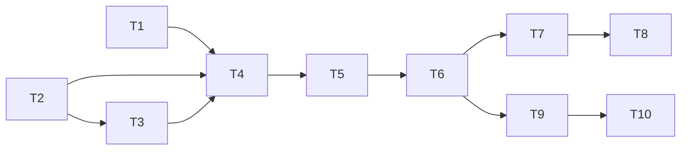

# tasks — incremental-review

依 test file 分組。例外：`internal/reviewer/incremental_test.go` 承載 S-02、S-05、S-07、S-08、S-09，拆成 T4／T5／T6 三個 task，原因是單一 task 會跨 6 個以上檔案，超過一次 dispatch 的範圍，且各組需各自的 RED/GREEN commit；後一個 task 只在前一個標 `[x]` 後才重開該檔。所有測試指令全機同時只跑一個。

## T1 `[x]` `S-01` [MODIFY] 設定與值域

- 檔案：`internal/config/config.go`（`Config`、`load` Enrichment 區塊 :235-241、`parseBoundedInt` :308）、`internal/config/envexample_test.go`（canonical :14 起，字母序）、`.env.example`、`internal/config/incremental_test.go`（NEW）
- RED：`TestIncrementalConfig`（REQ-01 / S-01）：未設 → `Enabled=false`、`FullEvery=5`；`MRI_INCREMENTAL_REVIEW=yes` → false 不報錯；`MRI_INCREMENTAL_FULL_EVERY=-1`、`=101` 回錯且訊息含變數名與 `invalid value`；`=0` 合法；兩變數在 canonical 清單。
- GREEN：`IncrementalConfig` 欄位與解析；canonical 清單與 `.env.example` 加兩行。
- REFACTOR：SOLID＋DRY 檢查，只在發現違規時改。
- Spec re-check：`/stdd-lint`。
- Verification command: `go test ./internal/config/ -run 'TestIncrementalConfig|TestEnvExample' -count=1 -v`

## T2 `[x]` `S-06` [MODIFY] GitLab client 新欄位與兩個新方法

- 檔案：`internal/gitlab/types.go`（`MergeRequest` :9、`Change` :21、`MRChangesResponse` :43、`Note` :48）、`internal/gitlab/client.go`（`getJSON` :165）、`internal/interfaces/interfaces.go`（`IGitLabClient` :13）、`internal/testfake/gitlab_client.go`（`FakeGitLabClient` :104）、`internal/reviewer/reviewer_test.go`（`fakeGitLab` :517）、`internal/gitlab/incremental_client_test.go`（NEW）
- RED：`TestClient_IncrementalEndpoints`（REQ-05 / S-06），httptest server：解出 `MergeRequest.SHA`、`DiffRefs.BaseSHA`、`MRChangesResponse.SHA`、`Note.CreatedAt`／`UpdatedAt`；merge_base query 恰含 `refs[]=aaa`、`refs[]=bbb` 並回 `id`；compare 含 `from=aaa`、`to=bbb`、`straight=true`，解出 `Diffs`（`a_mode`、`b_mode`、`too_large`、`collapsed`）與 `CompareTimeout`；404 時兩方法回 error。stub：新欄位先加上（不帶 json tag），方法簽章先回 `errors.New("not implemented")`，使 RED 以斷言失敗而非編譯錯誤收場。
- GREEN：欄位、`CompareResponse`、`GetMergeBase`、`Compare`；介面加兩方法；兩個 fake 實作並記錄呼叫次數（`fakeGitLab` 另補 `PostNote`、`GetMRChanges`、`GetMergeRequest`、`ListNotes` 計數），供 T4–T6 斷言。
- REFACTOR：SOLID＋DRY 檢查。
- Spec re-check：`/stdd-lint`；`go build ./... && go vet ./...` 綠。
- Verification command: `go test ./internal/gitlab/ -run TestClient_IncrementalEndpoints -count=1 -v`

## T3 `[x]` `S-03,S-04` [NEW] state 純函式與決策

- 檔案：`internal/reviewer/incremental_state.go`（NEW）、`internal/reviewer/incremental_state_test.go`（NEW）
- RED：`TestState_ParseFormatAndSelect`（REQ-03 / S-03）照 spec 的 7 則 note 選中 ID 30，並驗 `ParseState(FormatState(s))==s`（full、update、round=2147483647）；`TestDecide_Table`（REQ-04 / S-04）逐列覆蓋 spec `## Decision tables` 六列，另加 `FullEvery=0` 的一列；`isAncestor` 為 `func() bool`，並斷言前四列不呼叫它（design-be 決定 6）。stub：`State`、`FormatState`、`ParseState`、`SelectPrior`、`Decide` 的簽章，一律回零值，使測試以斷言失敗而非編譯錯誤收場。
- GREEN：依 spec REQ-03 格式（40 位小寫 hex、round 放得進 int32）與身分三條件（第一行等於 marker、`author.id` 非 0 且等於 bot ID、`created_at==updated_at`）實作。
- REFACTOR：SOLID＋DRY 檢查。
- Spec re-check：`/stdd-lint`。
- Verification command: `go test ./internal/reviewer/ -run 'TestState_ParseFormatAndSelect|TestDecide_Table' -count=1 -v`

## T4 `[x]` `S-02,S-05` [MODIFY] 關閉路徑 golden 與 skip

- 檔案：`internal/reviewer/reviewer.go`（`Run` :179、deferred log :186-196、`fetchMRDetails` :297）、`internal/reviewer/incremental.go`（NEW：`incrementalRun`、`planIncremental`）、`internal/reviewer/incremental_test.go`（NEW）
- RED：
  - `TestIncremental_DisabledPathUnchanged`（REQ-02 / S-02）：特性測試。golden 字串取自**本 task 動 `Run` 之前**的實作輸出，寫成測試內字面常數。這個測試在 RED 時就會綠；為證明它能分辨（D6），builder 須暫時在 `postReviewWithFooter` 的 body 插入 `mrinspect:state` 跑一次看到 FAIL，再還原，兩次輸出都引用；再做第二個暫時變更（把 upsert 改成 `PostNote`，或改動 body 一個字元），證明 golden 字串與呼叫次數斷言也會 FAIL，同樣還原並引用輸出。
  - `TestIncremental_SkipSameHead`（REQ-04 / S-05）：single 與 multi 各一次；模型、`PostNote`、`UpdateNote`、`GetMRChanges`、`GetMergeBase`、`Compare` 皆 0 次；Info 含 `incremental: head unchanged`；`MRInspect completed` 且 success=true。
- GREEN：`Run` 在 `cfg.Incremental.Enabled` 時呼叫 `planIncremental`（pin head／base、`CurrentUser`、`ListNotes`、`SelectPrior`、`Decide`，merge_base 只在需要時呼叫）；skip 時在 `fetchDiff` 前 return 並標 success。full／update 分支本 task 先一律走既有路徑（T5、T6 補上）。
- REFACTOR：SOLID＋DRY 檢查。
- Spec re-check：`/stdd-lint`；既有 `TestPostReview_UpdatesExistingNote` 仍綠。
- Verification command: `go test ./internal/reviewer/ -run 'TestIncremental_DisabledPathUnchanged|TestIncremental_SkipSameHead|TestPostReview_UpdatesExistingNote' -count=1 -v`

## T5 `[x]` `S-07,S-09` [MODIFY] update review 與新 note

- 檔案：`internal/reviewer/incremental.go`（`fetchUpdateDiff`、`otherFilesSection`、`postIncrementalNote`）、`internal/reviewer/reviewer.go`（`Run` :179、`reduceDiff` :404）、`internal/reviewer/incremental_test.go`
- RED：
  - `TestIncremental_Update`（REQ-05 / S-07）：single 與 multi（兩個 lane，`modeRoutingProvider` 擷取每個 lane 的 prompt）；diff 只含 `x.go`（以 `diff.HasFileSection` 判定）；含 `Other files changed in this MR (not shown in this diff):` 與 `y.go`，該段不含 `x.go`；`PostNote` 1、`UpdateNote` 0；state `sha=B base=X mode=update round=1`；標頭 `Update review <A8>..<B8>`。
  - `TestIncremental_NoStateNoteDoesNotEnableSkip`（REQ-06 / S-09）。
  - 兩個測試都斷言 `GetMergeBase`、`Compare` 收到的 project ID 等於 validator 的 project ID（spec REQ-05 最後一條，design-be 決定 7）。
- GREEN：update 分支用 `Compare(prior.sha, head)`，不完整即改 full（design-be 決定 2）；檔案清單段（去重、排序、去控制字元、最多 200 條，超過寫 `... and <n> more` 並 `markDirty`）；`postIncrementalNote` 依 design-be 決定 5 組 body，開關開啟時只 `PostNote`，且 `len(dirty)==0` 才寫 state 行（本 task 的 dirty 來源只有檔案清單截斷與 update review 的 `GetMRChanges` sha 檢查；其餘來源 T6 補上）。
- REFACTOR：SOLID＋DRY 檢查（`otherFilesSection` 與既有 footer 檔案列表若重複則抽出）。
- Spec re-check：`/stdd-lint`；T4 兩個測試仍綠。
- Verification command: `go test ./internal/reviewer/ -run 'TestIncremental_' -count=1 -v`

## T6 `[x]` `S-08` [MODIFY] 降級與 state 寫入條件

- 檔案：`internal/interfaces/interfaces.go`（新增 `IDiffSourceFetcher`）、`internal/diff/local.go`（`Fetch` :23）、`internal/diff/api.go`（`Fetch` :31）、`internal/diff/fallback.go`（`Fetch` :22）、`internal/reviewer/reviewer.go`（`fetchDiff` :311、`fetchedDiff` :39）、`internal/reviewer/incremental.go`、`internal/reviewer/incremental_test.go`
- RED：
  - `internal/diff/source_sha_test.go`（NEW）`TestFetchWithSource_Local`（temp go-git repo，回傳 source branch 的 commit hash）、`TestFetchWithSource_API`（fake client，回傳 `MRChangesResponse.SHA`）、`TestFetchWithSource_Fallback`（local 失敗走 API，回 API 的 SHA；inner 不支援時回 `""`）。支撐 S-08 (g) 的 reviewed SHA 語意。
  - `TestIncremental_DegradeAndStateWriting`（REQ-06 / S-08）table-driven，spec 的 (a)–(i) 九列；每列 `PostNote` 1、`UpdateNote` 0、模型收到完整 MR diff；(a)–(e) state 為 `mode=full round=0` 且含 `Full review at`；(f)–(i) 不含 `mrinspect:state`；(b)–(i) 各一行 Warn。測試替身的 diff fetcher 實作 `FetchWithSource` 以控制 (g) 的 source SHA。T5 完成後 (a)–(e) 可能在 RED 時已綠（特性列）；RED 的失敗證據必須來自 (f)–(i) 與上面三個 diff 測試，回報時逐列標明哪些列 RED。
- GREEN：三個 fetcher 實作 `FetchWithSource`（`Fetch` 改為呼叫它，行為不變）；`fetchedDiff` 帶 `sourceSHA`、`changesSHA`、`changesOverflow`、`changesErr`；`markDirty` 涵蓋 REQ-06 五類原因；lane 失敗與 `degradedToSingle` 從既有回傳狀態取得。
- REFACTOR：SOLID＋DRY 檢查。
- Spec re-check：`/stdd-lint`；`go test ./internal/diff/ ./internal/reviewer/ -count=1` 全綠。
- Verification command: `go test ./internal/diff/ -run TestFetchWithSource -count=1 -v && go test ./internal/reviewer/ -run TestIncremental_DegradeAndStateWriting -count=1 -v`

## T7 `[x]` [INFRA] 文件同步

- 原因：只改文件，沒有可測行為；REQ-01 的文件要求以 grep 驗證。
- 步驟：`AGENTS.md` `## Key Environment Variables`（:101）加兩列；`docs/us/configuration.md`、`docs/tw/configuration.md`（:61 附近）加兩列；`docs/us/architecture.md`、`docs/tw/architecture.md` :37 補「`MRI_INCREMENTAL_REVIEW=true` 時每次另開新 note，不更新舊 note」。
- Verification command: `grep -c 'MRI_INCREMENTAL_REVIEW' AGENTS.md docs/us/configuration.md docs/tw/configuration.md docs/us/architecture.md docs/tw/architecture.md`（每檔 ≥1）

## T8 `[x]` [INFRA] 全套 gate

- 原因：跨 task 的整體回歸，不對應單一 scenario。
- 步驟：`go build ./...`、`go vet ./...`、`make lint`、`make vuln`、`go test ./... -count=1`，依序單獨跑。
- Verification command: `go test ./... -count=1 && make lint`

## T9 `[x]` `S-08` [MODIFY] spec v3：未送審內容與 changes SHA 不寫 state

- 來源：spec 實作後修訂（2026-10-26 使用者核准），S-08 新增 (j)–(p)、REQ-05 增量丟檔改全審。
- 檔案：`internal/reviewer/incremental.go`（`assessRun`、`fetchUpdateDiff`）、`internal/reviewer/reviewer.go`（`fetchDiff`、`reduceAndValidate`、`fetchedDiff` :39 的 `dropped`／`unavailable`／`changesSHA`）、`internal/reviewer/incremental_v3_test.go`（NEW）
- RED：`TestIncremental_DegradeAndStateWritingV3`（REQ-06 / S-08 (j)–(p)），table-driven；(j)、(k)、(m)、(n) 不含 `mrinspect:state` 且 Warn 指出原因；(l)、(o)、(p) 寫 full r0 state；(l) 模型收到完整 MR diff 而非增量。會寫 state 的列，fake `GetMRChanges` 回 `sha=<head>`、diff fetcher source commit 為 `<head>`。逐列回報哪些列在 RED 時已綠。
- GREEN：`assessRun` 讀 `changesSHA`（full review 不等於 pinned head → dirty）、以超出預算為由的 `dropped`（non-reviewable 不算）→ dirty、`too_large`／`collapsed`／`Truncated()` 且送審 diff 無該檔段落 → dirty；`fetchUpdateDiff` 增量 diff 經 `diffbudget` 以超出預算為由丟檔 → Warn 並改走 full review。
- REFACTOR：SOLID＋DRY 檢查。
- Spec re-check：`/stdd-lint`；既有 `TestIncremental_*` 與 `TestIncrementalRules_*` 全綠。
- Verification command: `go test ./internal/reviewer/ -run 'TestIncremental_DegradeAndStateWriting' -count=1 -v`

## T10 `[x]` `S-08` [MODIFY] spec v4：lockfile 與 binary 不算未送審

- 來源：spec 第二次修訂（2026-10-26 使用者核准），S-08 新增 (q)、(r)。
- 檔案：`internal/reviewer/incremental.go`（`unseenPaths`）、`internal/diff/sections.go`（binary 判定）、`internal/diffbudget/diffbudget.go`（若需匯出 non-reviewable 路徑判定）、`internal/reviewer/incremental_v4_test.go`（NEW）
- RED：`TestIncremental_DegradeAndStateWritingV4`（REQ-06 / S-08 (q)–(r)）：(q) collapsed lockfile、無 hunk、無超預算丟檔 → 寫 full r0 state；(r) too_large binary、送審 diff 有 `Binary files … differ` 行 → 寫 full r0 state。會寫 state 的列，fake `GetMRChanges` 回 `sha=<head>`、diff fetcher source commit 為 `<head>`。
- GREEN：`unseenPaths` 略過符合 non-reviewable 規則的路徑；該檔有 hunk 或有 `Binary files … differ` 行即視為已送審。
- REFACTOR：SOLID＋DRY 檢查（non-reviewable 判定只留一份來源）。
- Spec re-check：`/stdd-lint`；既有 `TestIncremental_*`、`TestIncrementalRules_*`、`TestHasFileHunk` 全綠。
- Verification command: `go test ./internal/reviewer/ -run 'TestIncremental_DegradeAndStateWriting' -count=1 -v`
## Manual verification checklist

- [ ] `S-10` [MANUAL] 真實 GitLab MR 端到端，依 spec S-10 的 8 步操作與預期 note 序列；記錄編輯 note 後 `updated_at` 是否改變。
  - 原因：需要真實 GitLab 實例與 CI pipeline，本機無法自動化。

## Task 依賴

## Requirements Checklist（引 spec 尾節，approval 時逐項對）

- [ ] S-01 → T1；文件 → T7
- [ ] S-02 → T4
- [ ] S-03 → T3
- [ ] S-04 → T3；S-05 → T4
- [ ] S-06 → T2
- [ ] S-07 → T5
- [ ] S-08 → T6；(j)–(p) → T9；(q)–(r) → T10
- [ ] S-09 → T5
- [ ] S-10 → Manual checklist
- [ ] D5 deferred 與已知限制：spec 已明列，plan 不另做
